# NubeBar

*[Léeme en español](README.md)*
*[How it works, part by part](ARCHITECTURE.md)*

A bar for Windows 11 with the shape and the temperament of the iPhone's Dynamic
Island: a black cloud that lives at the very top, expands when you hover it and
unfolds panels from inside itself. It replaces the Windows taskbar and is
configured with a single `config.json`, Linux-rice style.

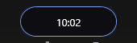

Collapsed, it only shows the clock. Move the mouse near it and it opens:

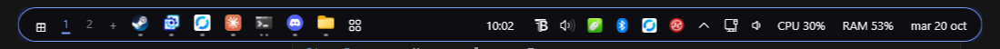

## What it does

**The bar**
- *Island* mode (floating, centred) or *bar* mode (edge to edge), top or bottom.
- Hides the Windows taskbar — the main one and the secondary ones — and gives
  them back untouched when it closes.
- **It floats, or it keeps its place. Your call.** Out of the box the cloud
  floats and windows pass underneath. Turn on "reserve screen space" and Windows
  keeps its strip the way it does for the taskbar, so maximised windows only
  reach the point where the cloud starts — a real appbar, and it works the same
  in island mode as in bar mode.
- **Twenty-five modules** you can place across three zones (left, centre,
  right): `inicio`, `apps`, `fijadas`, `reloj`, `fecha`, `cpu`, `ram`,
  `bateria`, `pila`, `bandeja`, `control`, `red`, `volumen`, `teclado`,
  `escritorios`, `monitores`, `notificaciones`, `musica` (or just its cover art,
  or just its bars), `wallpaper` (or just the wallpaper title), `iconos`, `nube`,
  `separador`. You pick and reorder them by dragging in **Settings → Modules**,
  and the ones you don't want are kept in the library instead of deleted.
- Accent-coloured edge and glow, with spring animations running at your
  monitor's refresh rate.
- **It gets out of the way.** Grab it and drag it wherever you like. While you
  hold it, it won't open, and it stays where you dropped it for as long as you
  keep hold of it; the moment you move the mouse away, it springs back home.
- The island **takes the shape of what it is showing**: with a narrow panel it
  stays collapsed instead of stretching edge to edge.

**Apps**
- A carousel of your open windows, grouped by program, with the scroll wheel to
  move through them and a configurable limit of visible icons.
- Click to activate, click the one already in front to minimise it, and a mini
  list to choose between windows of the same program. It appears as a **card
  pinned to its icon**, as wide as the longest title — not as a strip running
  from one side of the screen to the other.
- **Pinned apps**: right-click an icon to pin it. They stay put whether open or
  not; closed ones look dimmed and clicking them launches the app.
- **Reorder by dragging**: grab an icon inside the island, take it where you
  want and the rest step aside. The order is saved and survives reboots.
- **Close from the island**: right-click an icon to close that app, or **force
  it to quit** the way "End task" does. Right-click the island to close them
  all. All three ask for confirmation before doing anything.
- **Hide the island**: right-click the island → "Hide the island" and it leaves
  every screen. It comes back when you press the Windows key.
- An Exposé-style overview of every window, with a global shortcut.

  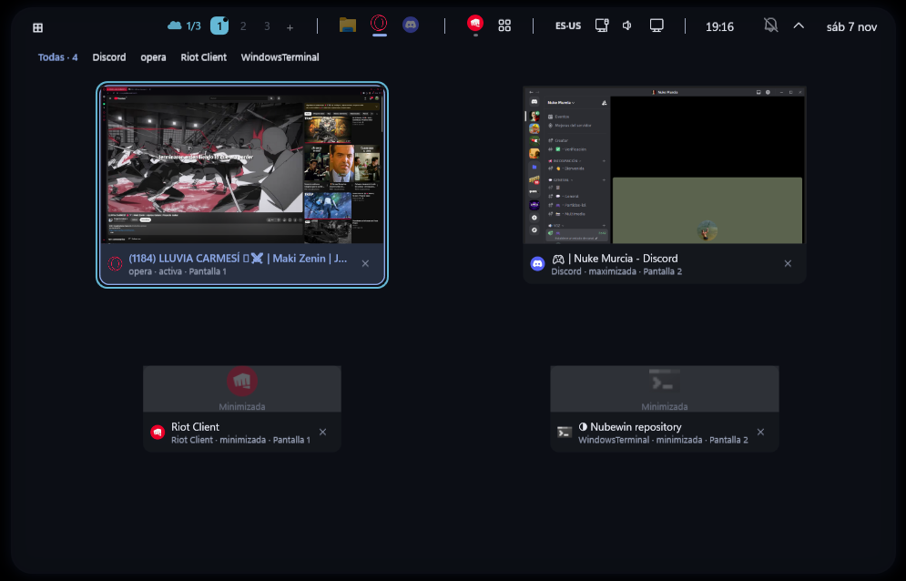

- **Snap windows to the edges**: drag a window to the left or right edge and it
  takes half the screen; to a corner, a quarter; to the top, maximised. Before
  you let go you see where it will land, and what you see is what happens: the
  snap lands on the screen the pointer is on, not the one the window came from.
  It respects the work area, so with "reserve space" on it won't slide under the
  island. It can be turned off in Settings.
- `NubeBar.exe --ventanas [report.txt]` lists which windows it can see and why it
  discards the rest, grouped by program. Read-only — it doesn't activate, move or
  close anything — and it exists so that "some of my apps are missing" can be
  investigated with data from your machine instead of by changing the filter
  blindly.
- `NubeBar.exe --diagvista [seconds]` opens the overview, leaves it still and
  counts what happens to it: reconciliations, full rebuilds (which are an
  anomaly), cards created or removed, thumbnails replaced, and which kind of
  Windows event each notice came from. Stop any running NubeBar first, because it
  starts a real one: the flicker it was built to measure only existed with the
  island and its animations running.

**Its own Start menu**
- Opens with the Windows key (intercepted without breaking any `Win+…`
  combination).
- Search for applications, open windows, files (through the Windows Search
  index), a calculator, and web search.
- Pinned apps, a greeting, a music player, CPU and RAM graphs, mute, Do Not
  Disturb and the power buttons.

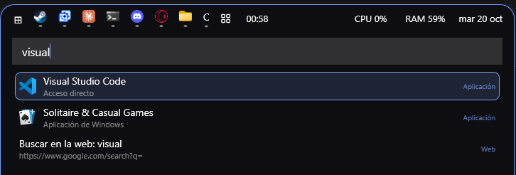

**Several screens**
- One island per monitor, each with its own DPI and its own width.
- Each island shows only the apps on its screen; move a window to another
  monitor and its icon travels from one island to the other, with animation.
- The Start menu, the overview and the settings window open on the screen your
  mouse is on.
- Plugging in, unplugging or rotating a monitor rearranges the islands without
  restarting anything.

**Full screen**
- If something takes over a whole screen (F11, a video, a game), the island on
  *that* screen slides up and disappears; the other one stays where it is.
- Hold the mouse against the top edge for about 300 ms and it peeks out.
- A merely maximised window does not hide it.

**System tray**
- The tray icons (Discord, Steam, OneDrive, your antivirus…) with their tooltip,
  their left click, their right-click menu and their double click.
- They update live and come and go with animation; if there are many, a `^`
  flyout grows out of the island.
- When NubeBar closes, the icons go back to the Windows tray on their own.

**Control centre**
- Keyboard language, network, volume and battery icons; click them for a panel
  in the style of the iPhone's control centre.
- Master volume (a slider with its figure, `−` / `+` buttons in steps of 5, and
  the scroll wheel) and **per application**, an audio output picker, Bluetooth
  with its paired devices, and brightness over DDC/CI.
- **Scroll over the speaker** on the island: volume up and down without opening
  anything.
- **The keyboard volume keys**: the overlay shows up in the island instead of
  Windows' own (`Barra.TeclasVolumen`, switchable in Settings).
- **Keyboard language**: if you have more than one layout installed in Windows,
  its code shows up (`ES`, `EN`…). Click to move to the next one, like
  Win+Space, or scroll to go back and forth; in the control centre, all of them
  to choose from.

**Battery**
- Click the battery: percentage, whether it's charging and how long is left,
  battery saver, and the **power mode** (Efficiency / Balanced / Performance).

**Background apps**
- A `^` button next to the clock that unfolds the icons of background apps, like
  Windows' hidden icons. On by default (module `bandeja`).

**Network**
- Click the network icon: what you're connected to (Wi-Fi or cable) with its IP,
  its link speed and the adapter.
- The **Wi-Fi networks in range** with their signal and padlock. Click to
  connect: if you've joined before, straight in; if not, it asks for the password
  right there. If the password is wrong it isn't saved. Enterprise networks
  (802.1X) open in the Windows settings. There are buttons to disconnect and to
  scan again.
- **The ones you already know come first** (in bold) and the rest follow by
  signal, so yours doesn't get lost among the neighbours'. Five are shown at once
  and the rest with the scroll wheel: that way the island doesn't become a wall
  even with fifteen networks around. The title says how many there are in total.
- A built-in **speed test**: ping, download and upload against
  speed.cloudflare.com, with the figures moving live. Takes about 15 s.
- What your machine doesn't support doesn't show up: no battery, no battery
  icon; if the monitor doesn't answer DDC/CI, no brightness slider.

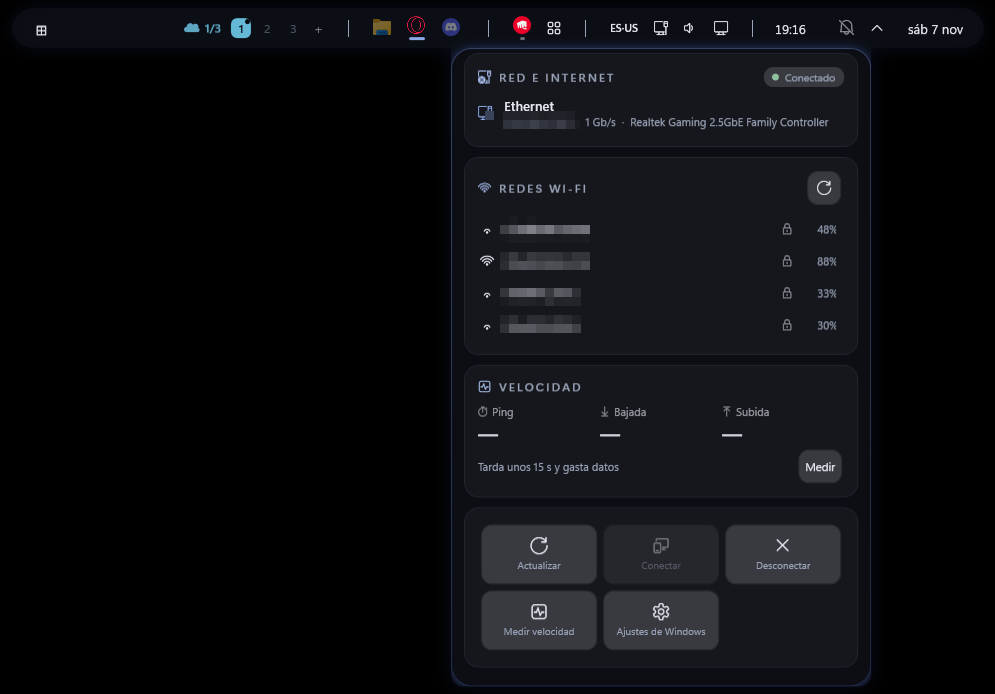

*(the network names and the IP are pixelated in this screenshot, not in the program)*

**Notices in the island**
- Change the volume and the island stretches out and shows an animated bar for
  1.5 s.
- Windows notifications peek out for a few seconds with the app name, the title
  and the text; click one and the app opens. It respects Do Not Disturb and you
  can mute specific apps. If you get them twice (Windows' and the island's), see
  [If notifications show up twice](#if-notifications-show-up-twice).

**Virtual desktops**
- Linux-style *workspace* numbers, with the current one in the accent colour.
- Click to switch, scroll to go to the next or previous one, and `+` to create.
- Optionally, the carousel shows only the apps on the current desktop.

**Monitors: switching the video input**
- The `monitores` module talks to each screen **over the cable** (DDC/CI, VCP
  `0x60`) and tells it which connector to switch to: put the monitor on HDMI to
  play on the console and bring it back to DisplayPort without crouching down to
  find the button underneath.
- It shows each monitor's real model — read from its EDID, not Windows' "Generic
  PnP Monitor" — whether it answers DDC/CI, which input it's on, and one button
  per input **that the monitor advertises**: if it doesn't advertise them, none
  are invented.
- You can nickname each screen ("PS5", "The big one"), stored against its EDID
  identity rather than against `DISPLAY1`, which Windows reshuffles on reboot.
- **It is not a capture card**: it changes the monitor's channel, it does not
  bring the HDMI image into a window. The icon only appears if some monitor on
  your machine manages its input.

**Themes**
- Nine built-in themes — Profesional, Oficina, Videojuegos, Invierno, Cyberpunk,
  Sakura, Samurái, Otoño and Sad — and a theme is more than a palette: it brings
  its own **shape** (how much each piece is rounded, or whether it goes
  chamfered), its **typeface**, its glow and its decorations.
- A colour editor by roles with an HSV picker: a theme defines ~130 named colours
  (`isla.fondo`, `panel.filo`, `icono.halo`…) and you can change the ones you
  want without touching the rest.
- **Your themes store the recipe, not the result**: what gets saved is which
  theme you started from and what you changed, not the 130 already-resolved
  colours. So if the base theme improves, yours improves with it — and the file
  is readable: thirty lines that say what you decided instead of a hundred and
  thirty that say nothing.
- They export and import as standalone files.

| Cyberpunk | Invierno |
|---|---|
| 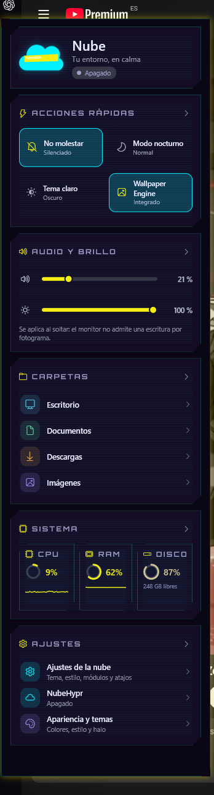 | 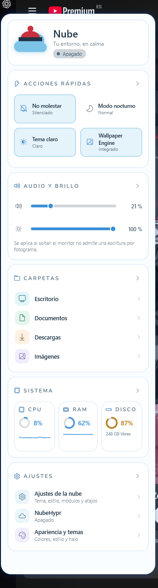 |

**The dock and the side panels**
- **Dock**: a row of icons floating over the desktop with your pinned and open
  apps. It is independent of the bar: you can have both, or just one.

  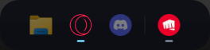

- **Side panels**: the left one brings your profile, quick actions, volume,
  brightness, folders and the state of the machine; the right one, notifications,
  the calendar and the current desktop.
- Both open the same way: always, never, or **when the mouse gets close** to the
  edge of the screen. The same edge gesture for both, deliberately: two
  vocabularies for the same thing would be two things to learn for one concept.

| Left panel | Right panel |
|---|---|
| 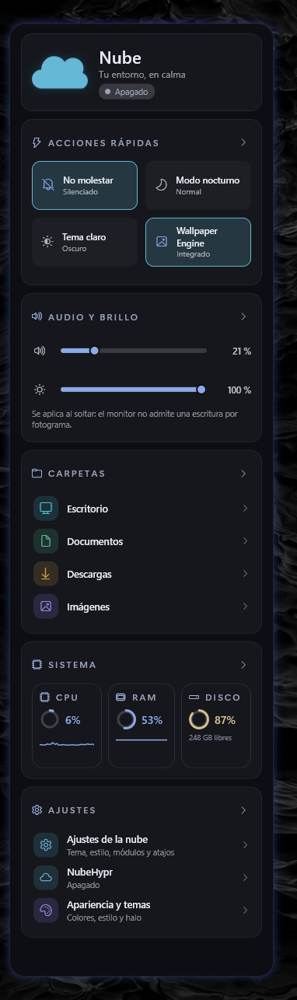 | 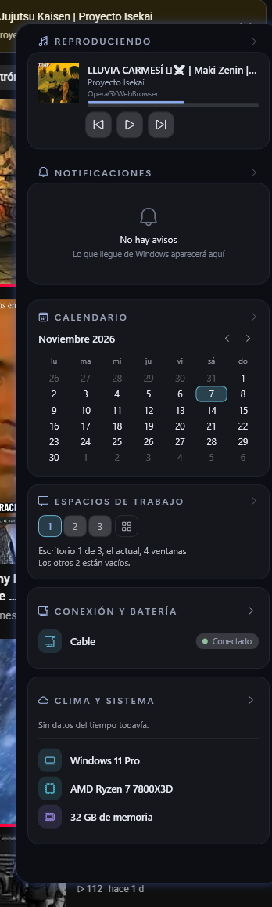 |

**NubeHypr: arranging windows**
- A window arranger in the style of Linux tiling managers, inside NubeBar. **It
  ships off**, and when on it has two modes: *simulation* — it works out what it
  would do and writes it to the log, without moving anything — and *apply*.
- Four layouts: **floating** (nobody moves), **horizontal** (columns),
  **vertical** (rows) and **main** (one big one on one side and the rest stacked
  on the other), with configurable gap and margin.
- **Rules** by process, class, title or path of the window: where it goes, on
  which desktop, whether it is ignored. With a search box, and a guide with eight
  examples using real applications that fill in the form with one click.
- It respects the work area: it subtracts the bar if the bar reserves space, and
  the dock.
- Its own shortcuts, and a module (`nube`) that tells you at a glance whether it
  is off, simulating or applying.

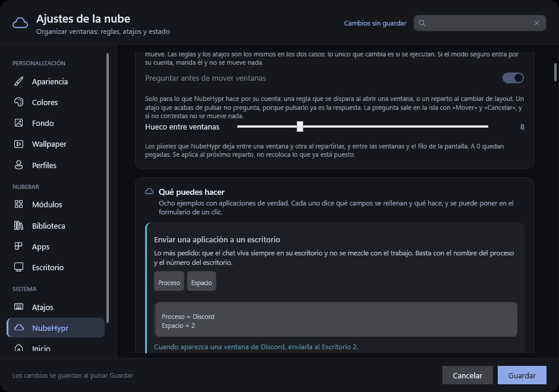

**The desktop background**
- NubeBar can set the background: solid colour, gradient or image, **and a
  different one per monitor**. With an image, you choose how it fits (fill crops;
  fit leaves the whole image; neither of them distorts it).

**Profiles**
- Save whole configurations and switch between them: one for work, one for
  gaming, one for when you plug in the projector.

**If it gets killed, the shell comes back the same**
- A guardian process (the same executable with `--guardian`) watches NubeBar. If
  you kill it from Task Manager, or it hangs, it gives back both taskbars and the
  "auto-hide" setting in under half a second, without restarting Explorer.

**Wallpaper Engine**
- Detects the current wallpaper and can pull the colour palette out of it
  (pywal-style).
- Pause, mute and hide icons from the island.
- It can send your accent colour to the wallpaper itself.

**Settings window**

Everything above is configured with the mouse and with a live preview, across
thirteen pages:

| Page | |
|---|---|
| **Appearance** | the theme, the shape, and how much everything moves |
| **Colours** | the theme's colours and their roles |
| **Background** | the desktop background, by type and by monitor |
| **Wallpaper** | Wallpaper Engine and how it ties into the startup scene |
| **Profiles** | configure your current profile |
| **Modules** | which widgets live in each zone of the cloud |
| **Library** | add, hide or remove widgets |
| **Apps** | the application carousel and the pinned ones |
| **Desktop** | the dock and the side panels |
| **Shortcuts** | the keyboard combinations |
| **NubeHypr** | arranging windows: rules, shortcuts and state |
| **Start** | its own Start menu and its search |
| **System** | startup, notifications and diagnostics |

And it speaks **Spanish and English**. The first time you open it, it asks which
one you want, and you can change it later in **Settings → Appearance →
Language**. If you close that window without choosing, Windows decides: Spanish
with the system in Spanish, English in any other case.

| Appearance | Modules |
|---|---|
| 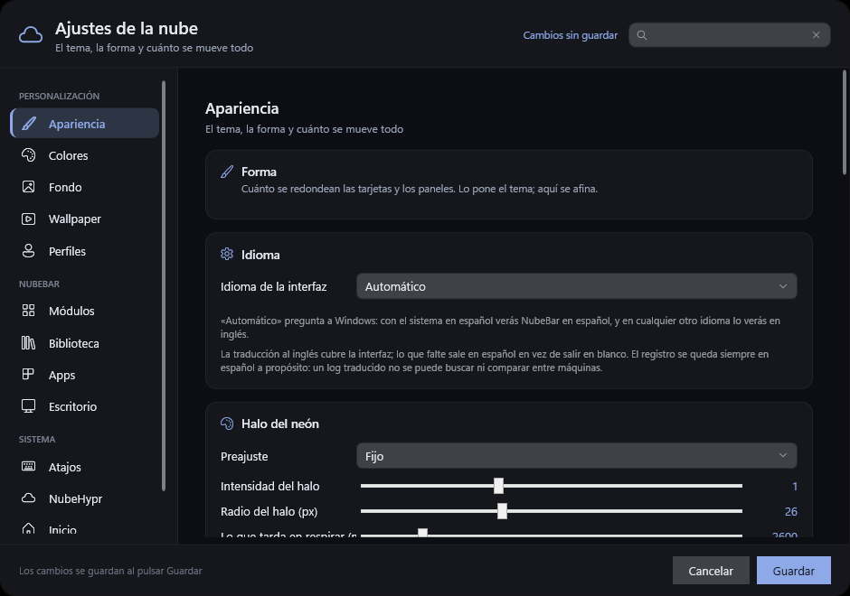 | 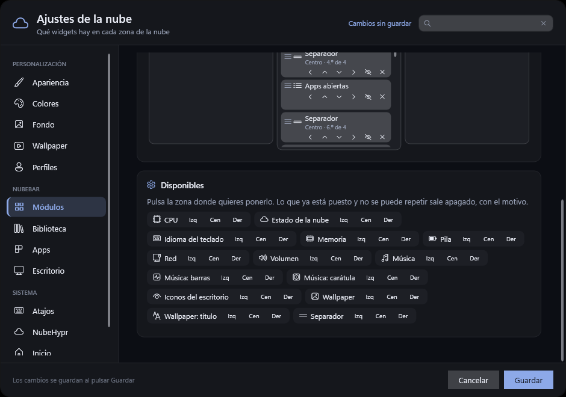 |

## Install

From the [latest Release](../../releases/latest), with or without the installer:

**With the installer** — download `NubeBar-Setup.exe` and open it. It installs
for your user under `%LOCALAPPDATA%\Programs\NubeBar`, **without asking for
administrator**, and leaves "start with Windows" ticked (otherwise you'd be left
without a bar on the next reboot). You remove it from "Installed apps" like any
other program.

**Without the installer** — download `NubeBar.exe`, move it to a permanent folder
and open it. It doesn't need .NET: everything is inside. Careful about opening it
straight from the browser's download bar: Chrome and friends run it from a
temporary folder of their own and delete it a few seconds later.

Either way, the first run creates `%APPDATA%\NubeBar\config.json` with the
default values, and the installer never touches it — not when updating, not when
uninstalling.

### Windows is going to warn you, and it's worth knowing why

The first time, a full-screen blue panel will come up:

> **Windows protected your PC**
> Microsoft Defender SmartScreen prevented an unrecognised app from starting.

It is not a virus and it is not an error: the installer **is not digitally
signed**. A signature is a certificate you have to buy from an authority every
year, and this project doesn't have one. Without it, Windows doesn't know who
made the program, and anything it doesn't recognise gets that banner — it happens
to every small program on the day it ships.

To carry on: **More info** → **Run anyway**. The "More info" link is what makes
the run button appear; if you don't click it, all you'll see is "Don't run".

And since you're about to trust a program that **hides your taskbar**, the honest
thing is to tell you how to check it instead of asking you to take our word:

- The whole source is in this repository. No binary is uploaded by hand: the
  `NubeBar.exe` and `NubeBar-Setup.exe` in each Release are built by
  [the GitHub workflow](.github/workflows/release.yml) from the tag, on a clean
  machine, and the log of every build is public.
- You can build it yourself (see [Build](#build)) and use your own executable.
- NubeBar does not install as administrator, it doesn't touch the Windows
  registry beyond its own uninstall entry, and the only thing it writes outside
  its own folder is `%APPDATA%\NubeBar`.
- If something goes wrong and you're left without a bar, read
  [If you end up without a taskbar](#if-you-end-up-without-a-taskbar): there is a
  guardian that gives it back, and a way to recover it by hand.

To make it start with Windows (or to stop it):
**Settings → System → Start with Windows**.

## Build

You need the .NET 10 SDK.

```powershell
git clone https://github.com/P542-X/NubeBar.git
cd NubeBar
dotnet build
```

To produce the standalone single-file executable:

```powershell
dotnet publish -c Release -r win-x64 --self-contained true `
               -p:PublishSingleFile=true -p:IncludeNativeLibrariesForSelfExtract=true `
               -o dist
```

The source lives in `src/`. Useful environment variables for debugging:

| Variable | What it does |
|---|---|
| `NUBEBAR_DIAG=1` | Logs the island's width and the app groups on every tick |
| `NUBEBAR_DIAG2=1` | Adds the carousel detail |
| `NUBEBAR_SINMASCARA=1` | Turns off the mask-key trick in the keyboard hook |
| `NUBEBAR_SIMULAR_ENERGIA=1` | Lock, sleep, restart and shut down are only written to the log |
| `NUBEBAR_NOTIS_PRUEBA=<folder>` | Reads notifications from that folder instead of Windows' |

The log lives at `%APPDATA%\NubeBar\nubebar.log`.

## Configure

The file is `%APPDATA%\NubeBar\config.json` and it hot-reloads: save it and the
island adapts on its own. Keys it doesn't recognise are kept as they are.

The key names stay in Spanish on purpose, even with the interface in English:
they are the same names the code uses, so what you read in the file, in
**Settings → Modules** and in the log all match.

### Theme

| Key | Default | What it does |
|---|---|---|
| `Tema.Fondo` | `"#E6000000"` | Background colour in ARGB; the first two digits are the opacity |
| `Tema.Texto` | `"#FFFFFF"` | Text colour |
| `Tema.Acento` | `"#7AA2F7"` | Accent colour: edge, glow and the little bar under the active app |
| `Tema.Radio` | `20` | Corner radius |
| `Tema.Fuente` | `"Segoe UI"` | Typeface |
| `Tema.TamanoFuente` | `13` | Text size |
| `Tema.DesdeWallpaper` | `false` | Pulls the colours from the current wallpaper |
| `Tema.EnviarColorAlWallpaper` | `false` | Sends your accent to Wallpaper Engine as `schemecolor` |
| `Tema.BordeAcento` | `true` | A 1 px edge and a soft glow in the accent colour |
| `Tema.Idioma` | `"auto"` | `"auto"` (follow Windows), `"es"` or `"en"` |
| `Tema.IdiomaPreguntado` | `false` | Whether the first-run language question has already been asked |

A fresh install starts on the **Profesional** theme (blue over deep blue). If you
already have a `config.json`, your theme is left alone. All nine built-in themes
are in **Settings → Appearance**.

#### Colour roles

All optional: whatever you leave out is **derived** from the background and the
text, so a theme can still be three colours and nothing changes. You set them
when the theme wants to be in charge, the way Nube does with its orange and its
blue, which can't be derived from the accent.

| Key | What it does |
|---|---|
| `Tema.Superficie` | Cards and rows inside a panel |
| `Tema.SuperficieAlta` | Whatever is hovered or selected |
| `Tema.Borde` | Separators and edges |
| `Tema.TextoAtenuado` | Second lines, units, hints |
| `Tema.Secundario` | Warm details; if missing, the accent itself |
| `Tema.Sistema` | Network, volume, battery; if missing, the accent itself |
| `Tema.Positivo` | The green of "all good" |
| `Tema.Aviso` | The amber of "careful" |
| `Tema.Negativo` | The red of "this is wrong" |

Every accent also has a **text** version, which is not configurable: it's the
same colour corrected so it can be read against the real background (WCAG, 3.5:1
over the island and 4.5:1 over a light surface). That's why a coral that works as
a fill deepens on its own when it becomes lettering.

### Animations

| Key | Default | What it does |
|---|---|---|
| `Animaciones.Nivel` | `"auto"` | `"auto"` (follows Windows), `"completo"`, `"equilibrado"` (40 % shorter and no bounce), `"reducido"` (no movement, but with very short fades) or `"desactivado"` (nothing: no movement, no fades) |
| `Animaciones.Robot` | `"primera-vez"` | When the startup scene is shown: `"primera-vez"`, `"cada-inicio"`, `"al-cambiar-tema"` or `"nunca"` |

With `"auto"` it reads **Accessibility → Visual effects → Animation effects** from
Windows: whoever has already asked for less movement there doesn't have to ask
again here.

### Bar

| Key | Default | What it does |
|---|---|---|
| `Barra.Modo` | `"isla"` | `"isla"` (floating) or `"barra"` (edge to edge) |
| `Barra.Posicion` | `"arriba"` | `"arriba"` (top) or `"abajo"` (bottom) |
| `Barra.Alto` | `38` | Height of the module row |
| `Barra.Margen` | `8` | Gap to the edge of the screen |
| `Barra.OcultarBarraWindows` | `true` | Hides the Windows taskbar while NubeBar is running |
| `Paneles[].ReservarEspacio` | unset (floats) | Reserves its strip, like the taskbar, so maximised windows don't cover it. Works in both modes; with `autoocultar` nothing is reserved |
| `Barra.MaxApps` | `10` | App icons visible at once; the rest with the scroll wheel |
| `Barra.AgruparApps` | `true` | Windows of the same program, in a single icon |
| `Barra.AtajoVistaGeneral` | `"Ctrl+Alt+W"` | Global shortcut for the overview |
| `Barra.AjustarAlArrastrar` | `true` | Dragging a window to an edge snaps it there, with a preview |
| `Barra.Monitores` | `"todos"` | `"todos"` (one island per screen) or `"principal"` |
| `Barra.AppsPorMonitor` | `true` | Each island shows only the apps on its screen |
| `Barra.OcultarEnPantallaCompleta` | `true` | The island hides if something takes over its whole screen |
| `Barra.OcultarConMaximizada` | `false` | It also hides for a merely maximised window (games, videos) |
| `Barra.Bandeja` | `true` | Brings in the system tray icons (needs the `bandeja` module) |
| `Barra.MaxBandeja` | `0` | Tray icons shown before the `^` flyout; with `0`, only the `^` (like Windows' hidden icons) |
| `Barra.Notificaciones` | `true` | Windows notifications peek out in the island |
| `Barra.NotificacionesSilenciadas` | `[]` | Fragments of app identifier that stay silent (e.g. `"Discord"`) |
| `Barra.AppsDelEscritorio` | `false` | The carousel shows only the apps on the current virtual desktop |
| `Barra.AppsFijadas` | `[]` | Apps always in view, in this order. With the `fijadas` module in place they show even with the island collapsed; take it out and they go in the carousel. Executable paths, or `shell:AppsFolder\<id>` for Store apps |
| `Barra.OrdenApps` | `[]` | The order you gave them by dragging the icons; written automatically |
| `Barra.Arrastrable` | `true` | The island moves aside when dragged, and icons reorder the same way |
| `Barra.SegundosParaVolver` | `1` | After the mouse leaves, how long until it springs back |
| `Barra.EscalaPaneles` | `0` | Size of panels and menus. `0` = according to the screen (on a 1920x1080 at 125 % they come out at ~86 %); `0.8` smaller; `1` as is |

### Modules

Lists of names; the order is the order they appear in.

```json
"Modulos": {
  "Izquierda": ["inicio"],
  "Centro":    ["fijadas", "apps", "reloj"],
  "Derecha":   ["cpu", "ram", "bateria", "bandeja", "control", "fecha"]
}
```

All twenty-five: `inicio`, `apps`, `fijadas`, `reloj`, `fecha`, `cpu`, `ram`,
`bateria`, `pila`, `bandeja`, `control`, `red`, `volumen`, `teclado`,
`escritorios`, `monitores`, `notificaciones`, `nube`, `musica`,
`musica-caratula`, `musica-barras`, `wallpaper`, `wallpaper-titulo`, `iconos`,
`separador`.

The list comes from the widget registry, so it is the same in the config, in
**Settings → Modules** and in the log. `musica-caratula` and `musica-barras` are
the cover art and the bars separately, for anyone who doesn't want both.

There is also a `Paneles` key, and since B5 it is **the authority** on the
cloud's geometry: edge, mode, thickness, margin, visibility, which monitors it
appears on and whether it reserves space. It is born on its own the first time
from `Barra` — nobody notices the change — and from then on `Barra.Modo`,
`Posicion`, `Alto`, `Margen`, `ReservarEspacio` and `Monitores` are *derived*
from it at load time and never written to the file: they are in the table above
because sixty-odd places in the code read them. Editing those keys by hand does
nothing; `Paneles` is what counts. It is plural so that adding a second panel, or
a side one, won't force anyone to change their `config.json`.

The **centre zone is always visible**, collapsed or expanded; the left and right
ones only when it expands. That's why the apps live there: `fijadas` (the icons
from `Barra.AppsFijadas`, open or not) and `apps` (the ones you have open right
now). They are one click away without moving the mouse closer, and they don't
shift position when the island expands, because the centre is the only zone that
doesn't move. If you prefer a small island at rest, move them to the left in
Settings → Modules.

### Start menu

| Key | Default | What it does |
|---|---|---|
| `Inicio.Fijadas` | `[]` | Paths of the pinned apps |
| `Inicio.TeclaWindows` | `true` | The Windows key opens this menu instead of Windows' |
| `Inicio.BuscarArchivos` | `true` | Also searches files through the Windows Search index |
| `Inicio.BuscadorWeb` | Google | Prefix for the web search |
| `Inicio.Saludo` | `true` | Header with "Good afternoon, …", the date and the time |

### Wallpaper

| Key | Default | What it does |
|---|---|---|
| `Wallpaper.Ruta` | `null` | Path to Wallpaper Engine; empty = detect it from Steam |
| `Wallpaper.Monitor` | `0` | Monitor the colours are read from (if there is only one island) |

## If you end up without a taskbar

NubeBar hides the Windows taskbar and sets it to "auto-hide" while it runs, and
puts it back the way it was when it closes. If you kill it outright (or it
hangs), it can be left hidden. To get it back:

1. **First, try opening NubeBar and closing it properly** (right-click the island
   → Quit). Closing cleanly gives the bar back along with the state saved in
   `%APPDATA%\NubeBar\barra-estado.txt`.

2. Otherwise, restart Windows Explorer:

   ```powershell
   Stop-Process -Name explorer -Force
   ```

   Windows opens it again on its own, with its usual taskbar.

3. If the bar comes back but is still on "auto-hide", turn it off in
   **Settings → Personalisation → Taskbar → Taskbar behaviours → Automatically
   hide the taskbar**.

**The Windows key** also comes back on its own: the keyboard hook uninstalls on
close and, if the process dies, Windows discards it by itself. If it still
doesn't respond, restart Explorer with the command above.

## If notifications show up twice

That's what Windows' default setup does. NubeBar doesn't receive notifications
directly: it reads them from the database where Windows stores them (the official
route would mean packaging and signing it). So it finds out **after** Windows has
already shown its own banner, and it can't prevent it. Both appear.

To keep just one:

**Only the island's (recommended).** Remove Windows' pop-up banner, but let the
notifications keep being stored:

1. **Settings → System → Notifications**.
2. Go into each app that notifies you (Discord, mail, WhatsApp…).
3. Turn off **Show notification banners**.
4. Do **not** turn off *Show notifications in notification centre*: that is where
   NubeBar reads them from, and without it they would disappear from the island
   too.

Windows 11 has no master switch for banners; it has to be done app by app.

**Only Windows'.** Set `Barra.Notificaciones` to `false` (or switch it off in
Settings). NubeBar stops reading them altogether: they neither peek out in the
island nor reach its notification centre.

> **Don't use "Do Not Disturb" for this:** NubeBar respects it, so it would
> silence both (the island's are still stored in its notification centre).

## Licence

**NubeBar is free, but it is not open source.** The full text is in
[LICENSE](LICENSE); the short version:

| | |
|---|---|
| ✅ Use it free | on as many machines as you like, at home or at work |
| ✅ Copy it and share it | as it comes, at no charge |
| ✅ Read the source and build it | for yourself |
| ❌ Sell it | not on its own, not inside a paid bundle or service |
| ❌ Publish modified versions | tinker on your own machine all you want; distributing the result, no |
| ❌ Remove the attribution | the name and the notices travel with the program |

The source is visible for a specific reason, the one in the section above: a
program that replaces your taskbar has to be auditable. Being readable doesn't
make it resellable or republishable with changes.

For any other use, ask by opening an issue.

### What comes from elsewhere

That licence covers NubeBar's own code. Third-party components keep their own,
more permissive, and you can carry on using them under their own terms:

| Component | Licence |
|---|---|
| [ManagedShell](https://github.com/cairoshell/ManagedShell) | Apache-2.0 |
| Microsoft.Data.Sqlite | MIT |
| [Slions.VirtualDesktop](https://github.com/Slion/VirtualDesktop) | MIT |
| System.Data.OleDb | MIT |
| M PLUS Rounded 1c · Nunito · Orbitron · Rajdhani · Shippori Mincho · Zen Maru Gothic | SIL Open Font License 1.1 |

The typefaces travel with their licence alongside them, in `Fuentes/OFL-*.txt`,
which is what the OFL asks for.
