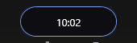
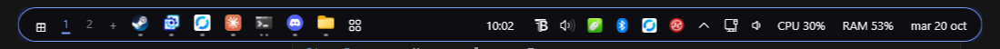
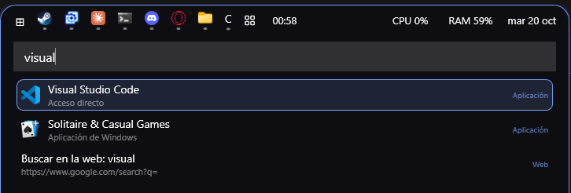
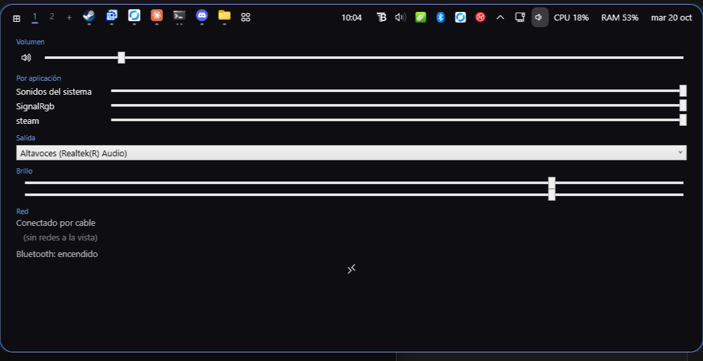
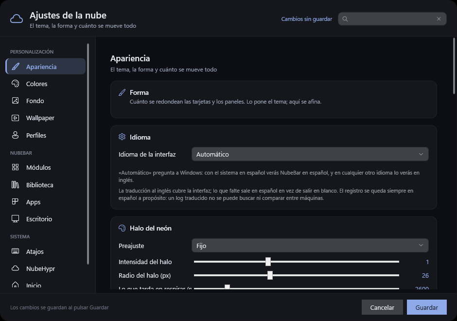

# NubeBar

Una barra para Windows 11 con la forma y el genio de la Dynamic Island del iPhone:
una nube negra que vive arriba del todo, se expande cuando le pasas el ratón por
encima y despliega paneles desde dentro de sí misma. Sustituye a la barra de tareas
de Windows y se configura con un único `config.json`, al estilo de un *rice* de Linux.



Recogida solo enseña el reloj. Al acercar el ratón se abre:



## Qué hace

**La barra**
- Modo *isla* (flotando, centrada) o modo *barra* (de lado a lado), arriba o abajo.
- Esconde la barra de tareas de Windows, la principal y las secundarias, y las
  devuelve intactas al cerrarse.
- En modo barra reserva su hueco como una appbar de verdad: las ventanas
  maximizadas no la tapan.
- Módulos colocables en tres zonas (izquierda, centro, derecha): inicio, apps,
  reloj, fecha, CPU, RAM, batería, música, bandeja, control, escritorios,
  wallpaper, iconos, separador.
- Borde y halo del color de acento, con animaciones de muelle a la velocidad de
  refresco del monitor.
- **Se aparta cuando molesta**: la coges y la arrastras donde quieras. Mientras
  la tengas cogida no se abre, y se queda donde la dejes todo el tiempo que
  sigas con ella; en cuanto le quitas el ratón de encima, vuelve sola a su
  sitio con un muelle.
- La isla **toma la forma de lo que enseña**: con un panel estrecho se queda
  recogida en vez de estirarse de lado a lado.

**Las apps**
- Carrusel con las ventanas abiertas, agrupadas por programa, con rueda para
  desplazarse y un límite configurable de iconos visibles.
- Clic para activar, clic en la que ya está delante para minimizarla, y una
  mini lista para elegir entre las ventanas de un mismo programa.
- **Apps fijadas**: clic derecho sobre un icono para anclarlo. Se quedan
  siempre, abiertas o no; cerradas se ven atenuadas y al pulsarlas se abren.
- **Se reordenan arrastrándolas**: coges un icono dentro de la isla, lo llevas
  donde quieras y los demás se apartan. El orden se guarda y aguanta reinicios.
- **Cerrar desde la isla**: clic derecho en un icono para cerrar esa app, o
  **forzar su cierre** como con «Finalizar tarea». Clic derecho en la isla para
  cerrarlas todas. Las tres piden confirmación antes de hacer nada.
- Vista general tipo Exposé con todas las ventanas, con atajo global.

**El menú Inicio propio**
- Se abre con la tecla Windows (interceptada sin romper ninguna combinación `Win+…`).
- Buscador de aplicaciones, de ventanas abiertas, de archivos (índice de Windows
  Search), calculadora y búsqueda web.
- Apps fijadas, saludo, reproductor de música, gráficas de CPU y RAM, silencio,
  No molestar y botones de energía.



**Varias pantallas**
- Una isla en cada monitor, cada una con su propio DPI y su propio ancho.
- Cada isla enseña solo las apps de su pantalla; al mover una ventana de monitor,
  su icono viaja de una isla a la otra con animación.
- El menú Inicio, la vista general y los ajustes se abren en la pantalla donde
  tengas el ratón.
- Enchufar, quitar o girar un monitor recoloca las islas sin reiniciar nada.

**Pantalla completa**
- Si algo ocupa una pantalla entera (F11, un vídeo, un juego), la isla de ESA
  pantalla se desliza hacia arriba y desaparece; la otra sigue en su sitio.
- Con el ratón pegado al borde superior unos 300 ms, asoma.
- Una ventana simplemente maximizada no la esconde.

**Bandeja del sistema**
- Los iconos de la bandeja (Discord, Steam, OneDrive, el antivirus…) con su
  tooltip, su clic izquierdo, su menú de clic derecho y su doble clic.
- Se actualizan en vivo y entran y salen con animación; si hay muchos, un
  desplegable `^` que nace de la isla.
- Al cerrar NubeBar los iconos vuelven solos a la bandeja de Windows.

**Centro de control**
- Iconos de red, volumen y batería; al pulsarlos, un panel al estilo del centro
  de control del iPhone.
- Volumen general y **por aplicación**, selector de salida de audio, lista de
  redes wifi, Bluetooth con sus dispositivos emparejados y brillo por DDC/CI.
- Lo que tu equipo no admite no aparece: sin batería no hay icono de batería, y
  si el monitor no contesta a DDC/CI no hay deslizador de brillo.



**Avisos en la isla**
- Al cambiar el volumen, la isla se estira y enseña una barra animada 1,5 s.
- Las notificaciones de Windows asoman unos segundos con el nombre de la app,
  el título y el texto; al pulsarlas se abre la app. Respeta «No molestar» y
  puedes silenciar apps concretas.

**Escritorios virtuales**
- Numeritos tipo *workspaces* de Linux, con el actual en color de acento.
- Clic para cambiar, rueda para ir al siguiente o al anterior y `+` para crear.
- Opcionalmente, el carrusel enseña solo las apps del escritorio actual.

**Si la matan, el shell vuelve igual**
- Un proceso guardián (el mismo ejecutable con `--guardian`) vigila a NubeBar.
  Si la cierras desde el Administrador de tareas, o se cuelga, devuelve las dos
  barras de tareas y el «ocultar automáticamente» en menos de medio segundo,
  sin reiniciar el Explorador.

**Wallpaper Engine**
- Detecta el fondo actual y puede sacar de él la paleta de colores (tipo pywal).
- Pausa, silencio y ocultar iconos desde la isla.
- Puede mandarle tu color de acento al propio wallpaper.

**Ventana de ajustes**
- Todo lo anterior se configura con ratón y con vista previa en vivo.
- Temas listos, selector de color HSV, exportar e importar temas.



## Instalar

1. Descarga `NubeBar.exe` de la [última Release](../../releases/latest).
2. Déjalo donde quieras y ábrelo. No necesita instalación ni .NET: lleva todo dentro.
3. La primera vez se crea `%APPDATA%\NubeBar\config.json` con los valores por defecto.

Para que arranque con Windows: **Ajustes → Sistema → Arrancar con Windows**.

## Compilar

Hace falta el SDK de .NET 10.

```powershell
git clone https://github.com/P542-X/NubeBar.git
cd NubeBar
dotnet build
```

Para generar el ejecutable autónomo de un solo archivo:

```powershell
dotnet publish -c Release -r win-x64 --self-contained true `
               -p:PublishSingleFile=true -p:IncludeNativeLibrariesForSelfExtract=true `
               -o dist
```

Variables de entorno útiles para depurar:

| Variable | Qué hace |
|---|---|
| `NUBEBAR_DIAG=1` | Apunta en el log el ancho de la isla y los grupos de apps en cada tick |
| `NUBEBAR_DIAG2=1` | Añade el detalle del carrusel |
| `NUBEBAR_SINMASCARA=1` | Desactiva el truco de la tecla máscara del gancho de teclado |
| `NUBEBAR_SIMULAR_ENERGIA=1` | Bloquear, suspender, reiniciar y apagar solo se apuntan en el log |
| `NUBEBAR_NOTIS_PRUEBA=<carpeta>` | Lee las notificaciones de esa carpeta en vez de las de Windows |

El log vive en `%APPDATA%\NubeBar\nubebar.log`.

## Configurar

El archivo es `%APPDATA%\NubeBar\config.json` y se recarga en caliente: al guardarlo,
la isla se adapta sola. Las claves que no reconoce se conservan tal cual.

### Tema

| Clave | Por defecto | Qué hace |
|---|---|---|
| `Tema.Fondo` | `"#E6000000"` | Color del fondo en ARGB; los dos primeros dígitos son la opacidad |
| `Tema.Texto` | `"#FFFFFF"` | Color del texto |
| `Tema.Acento` | `"#7AA2F7"` | Color de acento: borde, halo y la rayita de la app activa |
| `Tema.Radio` | `20` | Radio de las esquinas |
| `Tema.Fuente` | `"Segoe UI"` | Tipografía |
| `Tema.TamanoFuente` | `13` | Tamaño del texto |
| `Tema.DesdeWallpaper` | `false` | Saca los colores del wallpaper actual |
| `Tema.EnviarColorAlWallpaper` | `false` | Manda tu acento a Wallpaper Engine como `schemecolor` |
| `Tema.BordeAcento` | `true` | Filo de 1 px y halo suave del color de acento |

### Barra

| Clave | Por defecto | Qué hace |
|---|---|---|
| `Barra.Modo` | `"isla"` | `"isla"` (flotante) o `"barra"` (de lado a lado) |
| `Barra.Posicion` | `"arriba"` | `"arriba"` o `"abajo"` |
| `Barra.Alto` | `38` | Alto de la fila de módulos |
| `Barra.Margen` | `8` | Separación con el borde de la pantalla |
| `Barra.OcultarBarraWindows` | `true` | Esconde la barra de tareas de Windows mientras NubeBar esté abierta |
| `Barra.ReservarEspacio` | `true` | Solo en modo barra: reserva su hueco para que no la tapen las ventanas |
| `Barra.MaxApps` | `10` | Iconos de apps visibles a la vez; el resto, con la rueda |
| `Barra.AgruparApps` | `true` | Las ventanas del mismo programa, en un solo icono |
| `Barra.AtajoVistaGeneral` | `"Ctrl+Alt+W"` | Atajo global de la vista general |
| `Barra.Monitores` | `"todos"` | `"todos"` (una isla por pantalla) o `"principal"` |
| `Barra.AppsPorMonitor` | `true` | Cada isla enseña solo las apps de su pantalla |
| `Barra.OcultarEnPantallaCompleta` | `true` | La isla se esconde si algo ocupa su pantalla entera |
| `Barra.OcultarConMaximizada` | `false` | Se esconde también con una ventana maximizada (juegos, vídeos) |
| `Barra.Bandeja` | `true` | Traer los iconos de la bandeja del sistema (hace falta el módulo `bandeja`) |
| `Barra.MaxBandeja` | `6` | Iconos de bandeja visibles antes del desplegable `^` |
| `Barra.Notificaciones` | `true` | Las notificaciones de Windows asoman en la isla |
| `Barra.NotificacionesSilenciadas` | `[]` | Trozos de identificador de app que no avisan (p. ej. `"Discord"`) |
| `Barra.AppsDelEscritorio` | `false` | El carrusel, solo con las apps del escritorio virtual actual |
| `Barra.AppsFijadas` | `[]` | Apps siempre presentes en el carrusel, en este orden. Rutas de ejecutable, o `shell:AppsFolder\<id>` para las de la Store |
| `Barra.OrdenApps` | `[]` | El orden que les has dado arrastrando los iconos; se escribe solo |
| `Barra.Arrastrable` | `true` | La isla se aparta arrastrándola, y los iconos se reordenan igual |
| `Barra.SegundosParaVolver` | `1` | Tras quitarle el ratón de encima, cuánto tarda en volver a su sitio |

### Módulos

Listas de nombres; el orden es el orden en que salen.

```json
"Modulos": {
  "Izquierda": ["inicio", "apps"],
  "Centro":    ["reloj"],
  "Derecha":   ["cpu", "ram", "bateria", "fecha"]
}
```

Disponibles: `inicio`, `apps`, `reloj`, `fecha`, `cpu`, `ram`, `bateria`, `musica`,
`bandeja`, `control`, `escritorios`, `wallpaper`, `wallpaper-titulo`, `iconos`,
`separador`.

### Menú Inicio

| Clave | Por defecto | Qué hace |
|---|---|---|
| `Inicio.Fijadas` | `[]` | Rutas de las apps ancladas |
| `Inicio.TeclaWindows` | `true` | La tecla Windows abre este menú en vez del de Windows |
| `Inicio.BuscarArchivos` | `true` | Busca también archivos con el índice de Windows Search |
| `Inicio.BuscadorWeb` | Google | Prefijo de la búsqueda web |
| `Inicio.Saludo` | `true` | Cabecera con «Buenas tardes, …» |

### Wallpaper

| Clave | Por defecto | Qué hace |
|---|---|---|
| `Wallpaper.Ruta` | `null` | Ruta de Wallpaper Engine; vacío = detectarla desde Steam |
| `Wallpaper.Monitor` | `0` | Monitor del que se leen los colores (si solo hay una isla) |

## Si te quedas sin barra de tareas

NubeBar esconde la barra de Windows y la pone en «ocultar automáticamente» mientras
está en marcha, y la devuelve a como estaba al cerrarse. Si la matas de golpe (o se
cuelga) puede quedarse escondida. Para recuperarla:

1. **Lo primero, prueba a abrir NubeBar y cerrarla bien** (clic derecho en la isla →
   Salir). Al cerrarse limpiamente devuelve la barra y el estado guardado en
   `%APPDATA%\NubeBar\barra-estado.txt`.

2. Si no, reinicia el Explorador de Windows:

   ```powershell
   Stop-Process -Name explorer -Force
   ```

   Windows lo vuelve a abrir solo con su barra de tareas de siempre.

3. Si la barra vuelve pero sigue en «ocultar automáticamente», quítalo en
   **Configuración → Personalización → Barra de tareas → Comportamientos de la barra
   de tareas → Ocultar automáticamente**.

**La tecla Windows** también vuelve sola: el gancho de teclado se desinstala al cerrar
y, si el proceso muere, Windows lo descarta por su cuenta. Si aun así no responde,
reinicia el Explorador con el comando de arriba.

## Licencia

Sin licencia por ahora. Todos los derechos reservados.
